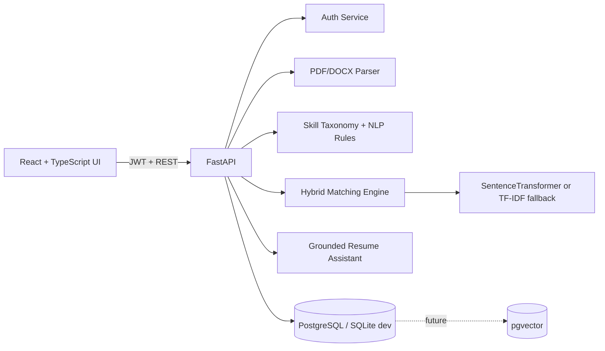

# HireSense AI Architecture

## MVP data flow
1. User registers/logs in and receives JWT.
2. Resume upload is validated and parsed using PyMuPDF or python-docx.
3. Skills are normalized through a reviewable taxonomy.
4. User saves a job description; required/preferred skills are extracted.
5. Match engine calculates semantic, skills, projects, and experience components.
6. Results are stored and shown with evidence-oriented missing/matched skills.
7. A learning roadmap is generated only from unverified job skills.

## Security choices
- bcrypt password hashing
- JWT expiry
- ownership checks for resume/job/match IDs
- file size/type validation
- CORS allow-list
- no API keys in source
- no resume data logged by the application
