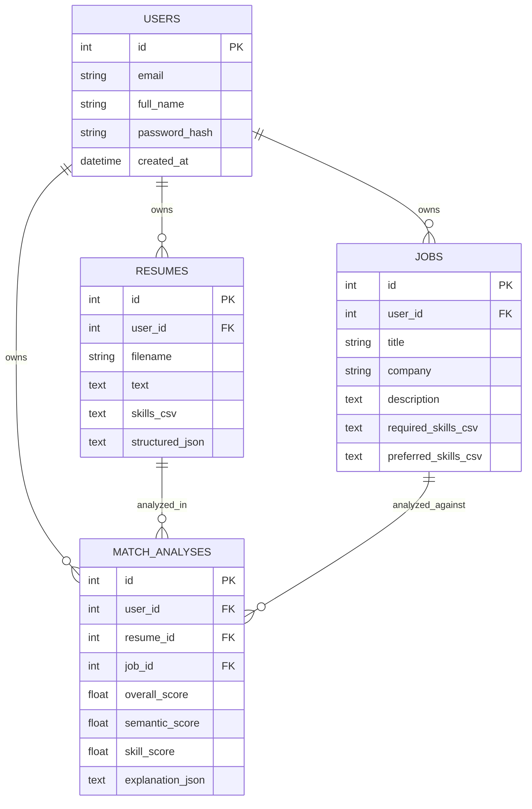

# ER Diagram

The MVP keeps several extracted collections serialized for simplicity. A production expansion can normalize `resume_sections`, `extracted_skills`, `job_requirements`, `skill_gaps`, `roadmap_progress`, and `resume_suggestions` as specified in the master brief.
